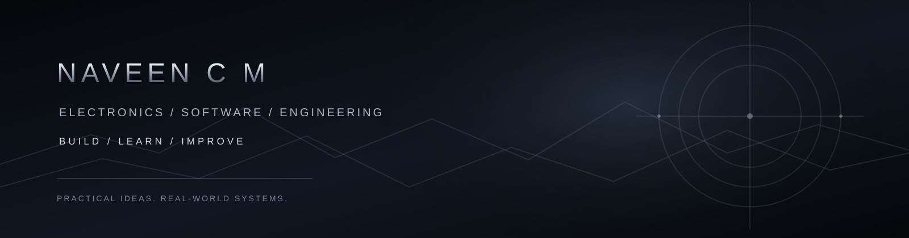

<!-- GitHub Profile README | Naveen C M -->

  

<h1 align="center">Naveen C M</h1>

  <strong>Electronics & Communication Engineering</strong> 
  Engineering practical solutions across hardware, software and connected systems.

  <a href="https://github.com/NaveenCM3852">GitHub</a> ·
  <a href="https://github.com/NaveenCM3852/chronos">CHRONOS</a>

---

## Profile

I’m an Electronics & Communication Engineering graduate interested in designing and building useful technology. My work spans Android application development, embedded systems, IoT and hardware prototyping.

I enjoy the complete engineering process: understanding a problem, building a working solution, testing it, and refining the result.

## Featured project

### CHRONOS — Personal Android Assistant

An ongoing native Android assistant project designed around reminders, smart scheduling, contextual assistance and controlled messaging integrations. CHRONOS combines a local-first data layer with Android system services, aiming to make everyday assistance useful without unnecessary background activity.

**Engineering highlights**
- Smart scheduling with an explicit review and handoff flow to Android Clock, plus date-specific fallback options.
- Event-driven reminders using Android alarm services, with reboot recovery and battery-conscious background scheduling.
- Persistent local data using Room and non-destructive database migrations.
- WhatsApp notification-based workflows and Telegram integration paths, with user-controlled permissions and settings.
- A custom monochrome, frosted-glass interface and an optional, user-enabled wake engine.

CHRONOS is actively being developed. Its source repository is currently private.

---

## Other projects

### Autonomous Water Surface Cleaning Boat
A catamaran-style engineering project designed to collect floating waste. The system combines onboard sensing, GPS/IMU-based navigation support, computer-vision detection and manual control.

### Vision Arm — Waste Segregation
A robotic-arm prototype designed to identify waste material categories and support automated segregation.

### [KTU Calculator](https://github.com/NaveenCM3852/ktu-calculator)
A browser-based academic tool for KTU students, featuring SGPA and CGPA calculations, target planning, percentage conversion and local calculation history.

**Live application:** [naveencm3852.github.io/ktu-calculator](https://naveencm3852.github.io/ktu-calculator/)

## Technical areas

- **Electronics & embedded systems:** circuit prototyping, microcontrollers, sensor integration and hardware interfacing.
- **IoT & connected devices:** connecting physical systems with software and data.
- **Software development:** Android application development, application logic and web interfaces.
- **Tools & platforms:** Kotlin, Arduino, Raspberry Pi, Git and MATLAB; practical programming with C, Python and JavaScript.

## Current direction

- Advancing CHRONOS through implementation, testing and technical documentation.
- Improving software architecture and Android development practices.
- Building and documenting practical electronics and embedded-system projects.

---

  <em>Build with curiosity. Improve through testing.</em>

